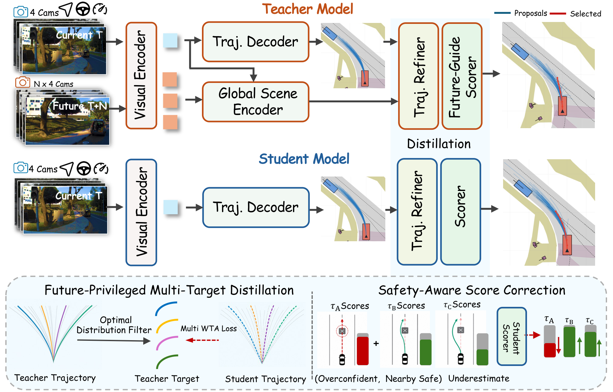

<h1 align="center">FPD-Drive: Future Policy Distillation for<br>End-to-End Autonomous Driving</h1>

<p align="center">
  <a href="https://arxiv.org/abs/2610.13232"><b>Paper (arXiv)</b></a> &nbsp;|&nbsp;
  <a href="https://huggingface.co/countnemochan/FPD-Drive-ckpt"><b>Checkpoints (Hugging Face)</b></a> &nbsp;|&nbsp;
  <a href="LICENSE"><b>Apache-2.0 License</b></a>
</p>

<p align="center">
  Li-Heng Chen<sup>1,2,*</sup>,
  Qifeng Chen<sup>1,*,†</sup>,
  Chengwei Wu<sup>1</sup>,
  Yingjie Zhang<sup>1</sup>,
  Sheng Yang<sup>1</sup>,
  Hongbo Fu<sup>2,✉</sup>,
  Shaoqing Ren<sup>1,3,✉</sup>
</p>

<p align="center">
  <sup>1</sup> NIO<br>
  <sup>2</sup> The Hong Kong University of Science and Technology<br>
  <sup>3</sup> University of Science and Technology of China
</p>

<p align="center"><sup>*</sup> Equal contribution. &nbsp; <sup>†</sup> Project lead. &nbsp; <sup>✉</sup> Corresponding authors.</p>


## Overview

**FPD-Drive transfers privileged future knowledge into a visual driving policy to improve both trajectory generation and selection.** A teacher uses recorded future observations during training to provide diverse, high-quality trajectory targets. A student learns from these targets and from evaluated safety outcomes of its own candidates. At deployment, the student plans using four current camera views, available ego-state history, and a navigation command, without future observations or teacher inference.

A logged driving scene contains only one executed trajectory and its associated future observations, leaving other valid behaviors weakly supervised. FPD-Drive addresses this limitation with two complementary objectives:

- **Future-Privileged Multi-Target Distillation** expands supervision beyond a single demonstration by transferring multiple safe, geometrically distinct teacher trajectories.
- **Safety-Aware Score Correction** improves candidate selection by correcting overconfident unsafe predictions and increasing confidence in underestimated safe alternatives.

The unscaled FPD-Drive achieves **94.88 PDMS** on NAVSIM v1, **54.75 EPDMS** on NAVSIM v2, and a preliminary **45.1 HD-Score** on HUGSIM. The scaled **FPD-Drive-Pro** achieves **95.57 PDMS** and **58.07 EPDMS** on NAVSIM v1 and v2, respectively.

<p align="center">
  <a href="assets/Overview.pdf">
    
  </a>
</p>

<p align="center"><em>FPD-Drive framework. Future observations support teacher training and target generation; only the student is used at deployment.</em></p>

# Contents 
- [x] Inference Code 
- [ ] Training Code 


## Quick start

Use Linux, Python 3.10+, and an NVIDIA GPU with BF16 support.

**1. Create and activate a Conda environment.**

```bash
git clone https://github.com/CountNemoChan/FPD-Drive.git
cd FPD-Drive
conda create -n fpd-drive python=3.10 -y
conda activate fpd-drive
python -m pip install --upgrade pip
python -m pip install -r requirements-inference.txt
```


**2. Configure your data and weights.** Replace these placeholders with local paths:

```bash
export NAVSIM_V1_ROOT=/path/to/navsim-v1-with-features
export OPENSCENE_DATA_ROOT=/path/to/openscene
export BACKBONE_WEIGHTS=/path/to/dinov2/model.safetensors
export METRIC_CACHE_PATH=/path/to/official/metric_cache
```

| Variable | What it points to |
| --- | --- |
| `NAVSIM_V1_ROOT` | Local [NAVSIM v1 fork with the required feature builders](https://github.com/valeoai/DrivoR); the repository root containing `navsim/`. |
| `OPENSCENE_DATA_ROOT` | Downloaded [OpenScene test data and nuPlan maps](https://github.com/autonomousvision/navsim/blob/main/docs/install.md), containing `navsim_logs/test/`, `sensor_blobs/test/`, and `maps/`. |
| `BACKBONE_WEIGHTS` | The `model.safetensors` file from [DINOv2 ViT-S/14 with registers](https://huggingface.co/timm/vit_small_patch14_reg4_dinov2.lvd142m), used by the image encoder. |
| `METRIC_CACHE_PATH` | Precomputed NAVSIM scene data used to calculate [PDM Score (PDMS, V1) or Extended PDM Score (EPDMS, V2)](https://github.com/autonomousvision/navsim/blob/main/docs/metrics.md). Select the cache for the benchmark being evaluated. |

For V2, also download `navhard_two_stage` from the dataset guide above and set:

```bash
export NAVSIM_V2_ROOT=/path/to/navsim-v2  # Official NAVSIM v2 devkit checkout
export SYNTHETIC_SENSOR_PATH=/path/to/navhard_two_stage/sensor_blobs  # Rendered camera images
export SYNTHETIC_SCENES_PATH=/path/to/navhard_two_stage/synthetic_scene_pickles  # Follow-up scene annotations
```

If you do not already have a cache, follow [Generate the metric cache of evaluation](#generate-the-metric-cache-of-evaluation)
below before running evaluation.

**3. Download checkpoints and run inference.** Download the compact weights from
[Hugging Face](https://huggingface.co/countnemochan/FPD-Drive-ckpt):

```bash
python -m pip install -U huggingface_hub
hf download countnemochan/FPD-Drive-ckpt --local-dir checkpoints/release
```

The presets use `base_v1.pt`, `base_v2.pt`, `pro_v1.pt`, and `pro_v2.pt` from
`checkpoints/release/` automatically. Example for Pro V1:

```bash
python run_inference.py --variant pro --benchmark v1 --check-inputs
python run_inference.py --variant pro --benchmark v1 --gpus 0
```

Choose `--variant base|pro` and `--benchmark v1|v2`. Default checkpoint paths are
relative to the repository root, even when launching from another directory.
Use `--checkpoint-path` or `CHECKPOINT_PATH` to override a checkpoint location.
Results are saved under `exp/evaluations/`. Add `--inference-only` to generate
trajectories without scoring, or `--print-config` to inspect the settings.

## Inference presets

The model combines `FPDplanner` and `Refiner`; checkpoint keys use
`fpd_planner.*` and `refiner.*` respectively.

The [four presets](configs/inference/) use the relative checkpoint paths above:

```bash
python run_inference.py --variant base --benchmark v1 --gpus 0
python run_inference.py --variant base --benchmark v2 --gpus 0
python run_inference.py --variant pro --benchmark v1 --gpus 0
python run_inference.py --variant pro --benchmark v2 --gpus 0
```

## HUGSIM evaluation

HUGSIM closed-loop evaluation is maintained separately in
[hugsim-fpd-drive](https://github.com/CountNemoChan/hugsim-fpd-drive).
Follow its README for setup and evaluation.

## Generate the metric cache of evaluation

With the data paths above configured, run the commands for your benchmark in an
environment with NAVSIM and nuplan-devkit installed. Use the resulting
`METRIC_CACHE_PATH` when running inference.

```bash
export NUPLAN_MAPS_ROOT="$OPENSCENE_DATA_ROOT/maps"  # Downloaded nuPlan map directory
export NUPLAN_MAP_VERSION=nuplan-maps-v1.0  # Map release used by NAVSIM
export NAVSIM_EXP_ROOT="$PWD/exp"  # Output directory for caches and logs
export OMP_NUM_THREADS=1  # CPU threads per worker
```

**V1 — NAVTEST (PDMS):**

```bash
export NAVSIM_DEVKIT_ROOT="$NAVSIM_V1_ROOT"  # Select the V1 devkit
export METRIC_CACHE_PATH="$NAVSIM_EXP_ROOT/metric_cache_v1"  # Output: NAVTEST scoring cache
PYTHONPATH="$NAVSIM_DEVKIT_ROOT:${PYTHONPATH:-}" \
python "$NAVSIM_DEVKIT_ROOT/navsim/planning/script/run_metric_caching.py" \
  train_test_split=navtest \
  cache.cache_path="$METRIC_CACHE_PATH" \
  cache.force_feature_computation=false \
  worker=single_machine_thread_pool \
  worker.use_process_pool=true worker.max_workers=16
```

**V2 — two-stage NAVHARD (EPDMS):** use the V2 paths configured above.

```bash
export NAVSIM_DEVKIT_ROOT="$NAVSIM_V2_ROOT"  # Select the V2 devkit
export METRIC_CACHE_PATH="$NAVSIM_EXP_ROOT/navhard_two_stage_metric_cache"  # Output: NAVHARD scoring cache
PYTHONPATH="$NAVSIM_DEVKIT_ROOT:${PYTHONPATH:-}" \
python "$NAVSIM_DEVKIT_ROOT/navsim/planning/script/run_metric_caching.py" \
  train_test_split=navhard_two_stage \
  metric_cache_path="$METRIC_CACHE_PATH" \
  synthetic_scenes_path="$SYNTHETIC_SCENES_PATH" \
  force_feature_computation=false \
  worker=single_machine_thread_pool \
  worker.use_process_pool=true worker.max_workers=16
```

## BibTex
```
@misc{chen2026fpddrivefuturepolicydistillation,
      title={FPD-Drive: Future Policy Distillation for End-to-End Autonomous Driving}, 
      author={Li-Heng Chen and Qifeng Chen and Chengwei Wu and Yingjie Zhang and Sheng Yang and Hongbo Fu and Shaoqing Ren},
      year={2026},
      eprint={2610.13232},
      archivePrefix={arXiv},
      primaryClass={cs.CV},
      url={https://arxiv.org/abs/2610.13232}, 
}
```

## Acknowledgement

We thank the authors of [DrivoR](https://github.com/valeoai/DrivoR),
[ChainFlow DiT](https://github.com/AFARI-Research/ChainFlow-VLA),
[HUGSIM](https://github.com/hyzhou404/HUGSIM), and
[NAVSIM](https://github.com/autonomousvision/navsim) for sharing their code and evaluation tools.

## License

The code is released under the [Apache License 2.0](LICENSE).
See [NOTICE](NOTICE) for upstream attributions.
